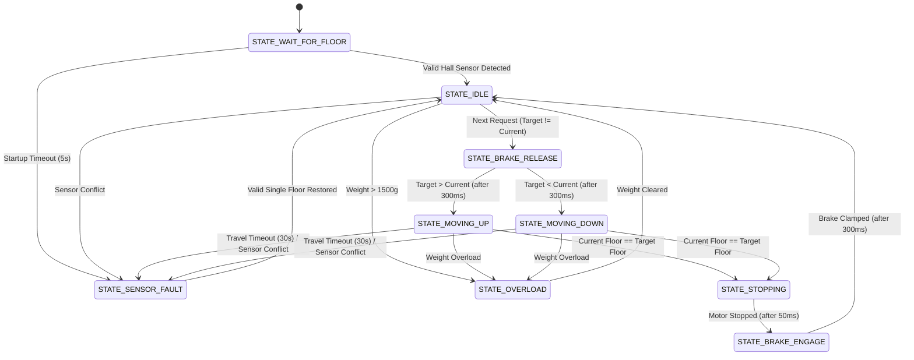

# Team 3 — Main Controller, Request Handler & Integration

## 1. Overview & Architecture
Team 3 serves as the master controller and systems integrator for the 4-floor Mini Elevator.
Team 3 implements:
- **Finite State Machine (FSM)**: Safe, deterministic state-driven elevator dispatching.
- **Request Handler**: Deterministic FIFO request queue using a fixed-size array (no bitmasks, no dynamic memory).
- **Safety Supervision**: Pre-flight weight verification, in-flight stall timeout, sensor conflict detection, and mechanical brake interlocking.
- **Master Super-Loop**: Coordinated 10 ms non-blocking update of all subsystem modules.

---

## 2. Request Handler Implementation (Simplified FIFO Array)

Per architectural guidelines, the complex bitmask and nearest-floor optimization were replaced with a simple, robust FIFO linear array:

```c
static unsigned char requests[FLOOR_COUNT];
static unsigned char request_count = 0;
```

### Key Principles:
1. **FIFO Order**: Requests are served in the exact order received (`GetNext()` returns `requests[0]`).
2. **Valid Floors**: Only `FLOOR_0` (0), `FLOOR_1` (1), `FLOOR_2` (2), and `FLOOR_3` (3) are accepted.
3. **No Duplicates**: `RequestHandler_Add()` ignores requests for floors already in the queue.
4. **Capacity Bounds**: Maximum capacity is `FLOOR_COUNT` (4). Further requests are ignored until space frees.
5. **Array Compaction**: When `RequestHandler_Remove(floor)` is executed, all subsequent elements shift left by one position, maintaining continuous FIFO ordering.
6. **Empty State**: When `request_count == 0`, `RequestHandler_GetNext()` safely returns `NO_FLOOR` (255).

---

## 3. Finite State Machine (FSM) Specification

The controller implements 9 deterministic states defined in `Shared/System_Types.h`:



### Detailed State Behaviors:
1. **`STATE_WAIT_FOR_FLOOR`**:
   - Power-on state. Cabin is stationary, brake clamped (`Brake_Engage()`).
   - Awaits initial floor identification from Team 2 Hall sensors.
   - If no valid floor detected within `FLOOR_DETECT_TIMEOUT_TICKS` (5.0 s), enters `STATE_SENSOR_FAULT`.
2. **`STATE_IDLE`**:
   - Cabin is parked at a landing, motor stopped, brake clamped.
   - Continuous checks: Overload (`Weight_IsOverload()`), Sensor Fault (`Inputs_IsFloorSensorFault()`).
   - If requests exist, dequeues target. If target == current floor, plays arrival chime and removes request immediately. Otherwise, commands `Brake_Release()` and enters `STATE_BRAKE_RELEASE`.
3. **`STATE_BRAKE_RELEASE`**:
   - Waits `BRAKE_RELEASE_TICKS` (300 ms) to allow servo brake caliper to fully retract before energizing motor.
   - Transitions to `STATE_MOVING_UP` or `STATE_MOVING_DOWN`.
4. **`STATE_MOVING_UP` / `STATE_MOVING_DOWN`**:
   - Drives motor via `Motor_Set(dir, MOTOR_SPEED_PERCENT)`.
   - Increments `travel_ticks`. If `travel_ticks >= MAX_TRAVEL_TICKS` (30.0 s), triggers stall timeout.
   - Constantly checks for overload and sensor faults.
   - When `current_floor == target_floor`, calls `Motor_Stop()` and enters `STATE_STOPPING`.
5. **`STATE_STOPPING`**:
   - Motor drive is cut (0% PWM).
   - Waits `STOP_SETTLE_TICKS` (50 ms) for mechanical inertia to dampen.
   - Calls `Brake_Engage()` and enters `STATE_BRAKE_ENGAGE`.
6. **`STATE_BRAKE_ENGAGE`**:
   - Waits `BRAKE_ENGAGE_TICKS` (300 ms) for mechanical friction pads to clamp pulley.
   - Removes completed request from queue, triggers `BUZZER_ARRIVAL`, resets target, and returns to `STATE_IDLE`.
7. **`STATE_OVERLOAD`**:
   - Cuts motor power, clamps brake, sounds `BUZZER_OVERLOAD`.
   - Queued calls are retained. System returns to `STATE_IDLE` once payload weight drops below 1500 g.
8. **`STATE_SENSOR_FAULT`**:
   - Emergency stop: cuts motor power, clamps brake, sounds `BUZZER_SENSOR_FAULT`.
   - Inhibits movement until sensor conflict is physically resolved and a single valid floor is reported.

---

## 4. Communication With Subsystems
Team 3 **never** touches PIC hardware registers belonging to other teams (no direct `PORTA`, `PORTB`, `PORTC`, `PORTD`, `PORTE` writes for motor, sensors, or display).
All interactions occur strictly through public header interfaces:
- Calls `Team_1_Motor/Motor.h`:
  - `Motor_Init()`, `Motor_Update()`
  - `Motor_Set()`, `Motor_Stop()`
  - `Brake_Release()`, `Brake_Engage()`
  - `Weight_GetGrams()`, `Weight_IsOverload()`
- Calls `Team_2_Inputs/Inputs.h`:
  - `Inputs_Init()`, `Inputs_Update()`
  - `Inputs_GetNewFloorRequest()`
  - `Inputs_GetCurrentFloor()`, `Inputs_IsFloorSensorFault()`
  - `Inputs_DisplayStatus()`, `Inputs_Buzzer()`

---

## 5. Main Loop Cycle Order
Inside `Team_3_Controller/Code/main.c`:
```c
while (1) {
    Motor_Update();       /* Team 1 */
    Inputs_Update();      /* Team 2 */
    Controller_Update();  /* Team 3 */
    Delay_ms(10);         /* 10 ms periodic tick */
}
```
All subsystem updates are non-blocking. Total CPU loop execution takes under 1 ms, leaving >90% idle margin.
